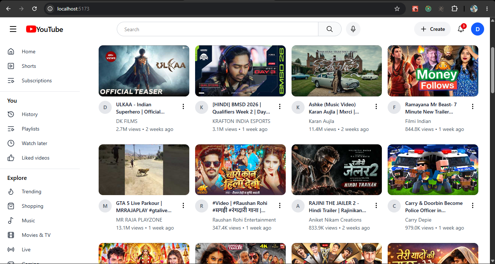
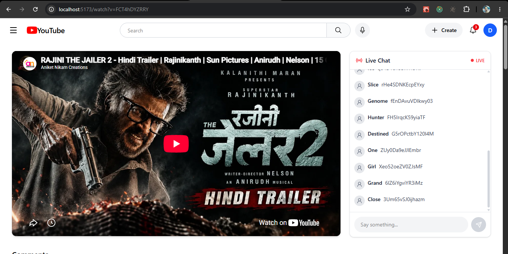
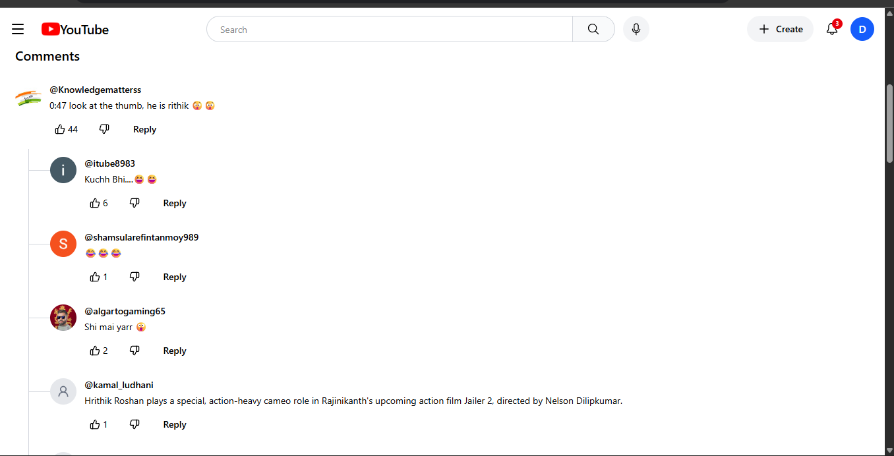

# YouTube Clone 

A responsive YouTube-inspired web application built using **React, Redux Toolkit, Tailwind CSS, and YouTube APIs**.

This project focuses on recreating the core YouTube experience while practicing modern React development, state management, API integration, routing, responsive UI, comments, and live chat functionality.

---

##  Screenshots

###  Home Page

###  Watch Page

###  Comments

---

##  Features

-  YouTube-style video browsing
-  Watch videos using YouTube embed
-  Comment section
-  Live chat simulation
-  Responsive sidebar navigation
-  Client-side routing
-  Redux Toolkit state management
-  API integration
-  Responsive design
-  Tailwind CSS UI
-  Live chat polling simulation

---

## Tech Stack
- React
- JavaScript
- Tailwind CSS
- Redux Toolkit
- React Router
- Lucide React
- Vite